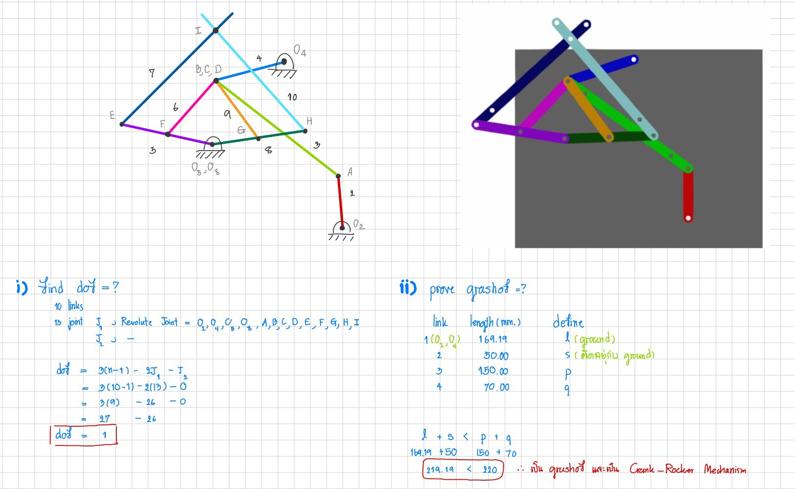

# 90-Degree Pick and Place Mechanism

**นายอธิคุณ เนตรสุวรรณ (Athikhun Netrsuwarn)**  
รหัสนิสิต 6730564421  
วิชา 2103322 Design of Mechanism (Mech Machinery)  
ภาควิชาวิศวกรรมเครื่องกล คณะวิศวกรรมศาสตร์ จุฬาลงกรณ์มหาวิทยาลัย (ภาคการศึกษาที่ 1/2569)

---

## Project overview

- **Project name:** 90-Degree Pick and Place Mechanism (10-Bar Planar Linkage)
- **Problem / purpose:** ออกแบบและจำลองกลไกหยิบ-วางชิ้นงานทำมุม 90 องศา (90° Pick and Place Mechanism) โดยใช้ต้นกำลังขับเคลื่อนแบบหมุนต่อเนื่องเพียงตัวเดียว (1-DOF) เพื่อแปลงการหมุนของข้อเหวี่ยง (Crank) ให้ปลายแขนทำงานเคลื่อนที่ระหว่างตำแหน่งแนวตั้งและแนวนอนที่ทำมุมตั้งฉากกัน พร้อมวิเคราะห์ Position, Velocity, Acceleration, Workspace และ Actuator Torque ด้วย Simscape Multibody
- **Team:** นายอธิคุณ เนตรสุวรรณ (ทำเดี่ยว — รับผิดชอบ MATLAB / Simscape Multibody)
- **Scope:** การวิเคราะห์พื้นฐานอย่าง Kinematic Diagram, DoF, Grashof Condition และการจำลองด้วย Simscape Multibody Simulation *(เนื่องจากทำคนเดียวจึงไม่รวมส่วน Symbolic Math และการสร้าง Physical Prototype)*
- **Status:** Completed (Simulation & Documentation)
- **Last updated:** 2026-11-19

---

## Repository structure

โครงสร้างไฟล์จัดเรียงตามแนวทางของ Mechanical Engineering Project Template ดังนี้:

| Path | Purpose | Files included |
| :--- | :--- | :--- |
| `hardware/mechanical/` | ไฟล์โมเดล CAD 3 มิติ สำหรับนำเข้าใน Simscape | `Ground.step`, `R2 Brick5.step`, `R2 Brick7.step`, `R2 Brick9.step`, `R2 Brick15.step` |
| `simulation/` | ไฟล์โมเดลจำลอง Simulink/Simscape Multibody, สคริปต์พล็อตกราฟ และรูปภาพประกอบ Mask | `PickandPlace.slx`, `Machinery_MATLAB_Class3_Plot.m`, `4_bars.png`, `6_bars.png`, `Pick_and_Place.png` |
| `media/` | ภาพไดอะแกรมการคำนวณ, ภาพบล็อกและกราฟผลลัพธ์ (`4 Bars` / `6 Bars`) และวิดีโอจำลองการเคลื่อนที่ | `Calculation.jpg` (หา DOF และพิสูจน์ Grashof), `Simulink.png`, `PickandPlace.avi` (วิดีโอการเคลื่อนที่), Folder `4 Bars/` (`Blocks`, `Follower`, `Input`), Folder `6 Bars/` (`6 Graph`, `90Deg`, `Blocks`, `Correct Data`) |
| `README.md` | รายงานสรุปภาพรวมของโครงงาน วิธีรัน และผลการวิเคราะห์ทั้งหมด | `README.md` |

---

## Kinematic model & preliminary analysis

กลไก 90-Degree Pick and Place ที่พัฒนาขึ้นเป็นกลไกระนาบแบบ **10-Bar Linkage** ในระนาบ $X\text{-}Z$ โดยแบ่งโครงสร้างออกเป็น 2 ชุดย่อยที่ทำงานเชื่อมโยงกัน ได้แก่ **ชุดขับเคลื่อน 4-Bar Linkage** (Links 1–4) และ **ชุดส่งกำลังขยายการเคลื่อนที่ 6-Bar Linkage** (Links 5–10)

### 1. Links and joints definition

| Link | บทบาท (Role) | ไฟล์ CAD อ้างอิง | สีในโมเดล 3 มิติ | ข้อต่อที่เชื่อมต่อ (Joints) |
| :---: | :--- | :--- | :--- | :--- |
| **1** | Ground (ฐานยึด) | `Ground.step` | เทา | $O_2, O_4, O_5, O_8$ |
| **2** | Crank (ก้านขับต้นกำลัง) | `R2 Brick5.step` | แดง | $O_2, A$ |
| **3** | Coupler (ก้านเชื่อมส่งกำลัง) | `R2 Brick15.step` | เขียวอ่อน | $A, B$ (เชื่อมชุด 6-Bar ที่จุดร่วม $B, C, D$) |
| **4** | Rocker (ก้านโยกตาม) | `R2 Brick7.step` | น้ำเงิน | $B, O_4$ |
| **5** | Left Main Arm | `R2 Brick9.step` | ม่วง | $O_5, F, E$ |
| **6** | Left Connecting Link | `R2 Brick7.step` | ชมพูบานเย็น | $F, D, C$ |
| **7** | Left Output Arm (End-Effector) | `R2 Brick15.step` | น้ำเงินเข้ม | $E, I$ (จุดวัดวิถีปลายแขน) |
| **8** | Right Main Arm | `R2 Brick9.step` | เขียวเข้ม | $O_8, G, H$ |
| **9** | Right Connecting Link | `R2 Brick7.step` | ส้ม / เหลืองทอง | $G, C$ |
| **10** | Right Output Arm | `R2 Brick15.step` | ฟ้าอ่อน | $H, I$ |

### 2. Degrees of freedom (DoF) analysis

การคำนวณหาจำนวนองศาอิสระ (Degrees of Freedom) ของกลไกระนาบด้วยสมการของ **Grübler–Kutzbach**:

- จำนวนชิ้นส่วนทั้งหมด (Number of links): $n = 10$
- จำนวนข้อต่อแบบ Lower Pair (Revolute Joints): $J_1 = 13$ ได้แก่ $O_2, O_4, O_5, O_8, A, B, C, D, E, F, G, H, I$
- จำนวนข้อต่อแบบ Higher Pair: $J_2 = 0$

$$\begin{aligned} \text{DoF} &= 3(n - 1) - 2J_1 - J_2 \\ &= 3(10 - 1) - 2(13) - 0 \\ &= 3(9) - 26 - 0 \\ &= 27 - 26 \\ &= 1 \end{aligned}$$

**สรุปผล:** กลไกมีองศาอิสระเท่ากับ **$\text{DoF} = 1$** จึงสามารถควบคุมการเคลื่อนที่ของกลไกทั้งระบบได้อย่างสมบูรณ์ด้วยต้นกำลังขับเคลื่อนแบบหมุนเพียงตัวเดียวที่จุด $O_2$

### 3. Grashof condition (4-Bar driving stage)

พิจารณาเงื่อนไขของ **Grashof's Law** สำหรับชุดขับเคลื่อน 4-Bar Linkage ($O_2\text{--}A\text{--}B\text{--}O_4$) เพื่อตรวจสอบความสามารถในการหมุนครบรอบของก้านขับ:

| Link | ความยาว (mm) | การกำหนดตัวแปร (Parameter) |
| :--- | :---: | :--- |
| Link 1 ($O_2 O_4$) | $169.19$ | $l$ (Longest link — Ground) |
| Link 2 ($O_2 A$) | $50.00$ | $s$ (Shortest link — Adjacent to ground) |
| Link 3 ($AB$) | $150.00$ | $p$ (Intermediate link) |
| Link 4 ($O_4 B$) | $70.00$ | $q$ (Intermediate link) |

ตรวจสอบอสมการเงื่อนไข Grashof ($l + s < p + q$):

$$\begin{aligned} l + s &< p + q \\ 169.19 + 50.00 &< 150.00 + 70.00 \\ 219.19\text{ mm} &< 220.00\text{ mm} \end{aligned}$$

**สรุปผล:** เนื่องจาก $l + s < p + q$ ($219.19\text{ mm} < 220.00\text{ mm}$) และชิ้นส่วนที่สั้นที่สุด ($s$, Link 2) ยึดติดกับฐาน (Ground, Link 1) ชุดขับเคลื่อนจึงเป็นไปตามเงื่อนไข **Grashof Mechanism** ประเภท **Crank-Rocker Mechanism** โดย Link 2 สามารถหมุนได้ครบรอบ $360^\circ$ อย่างต่อเนื่อง เพื่อขับให้ Link 4 แกว่งไป-กลับและส่งกำลังต่อไปยังชุด 6-Bar Linkage

---

## Multibody simulation setup (Simscape Multibody)

แบบจำลองในไฟล์ `simulation/PickandPlace.slx` ถูกจัดโครงสร้างเป็น 2 Subsystem หลัก (`4 bars` และ `6 bars`) เชื่อมต่อกับ `World Frame`, `Solver Configuration` และ `Mechanism Configuration`

### Simulation parameters

- **Coordinate plane:** ระนาบการเคลื่อนที่ $X\text{-}Z$ (แกน $+X$ แนวนอน, แกน $+Z$ แนวตั้งชี้ขึ้น)
- **Gravity vector:** $\vec{g} = [0, 0, -9.80665]\text{ m/s}^2$
- **Body inertia & density:** คำนวณอัตโนมัติจากเรขาคณิตไฟล์ `.step` โดยกำหนดความหนาแน่น $\rho = 1000\text{ kg/m}^3$
- **Input actuation (Joint $O_2$):** ขับเคลื่อนด้วยความเร็วเชิงมุมคงที่ $\omega_2 = 2\text{ rad/s}$ ($\approx 19.10\text{ rpm}$), ความเร่งเชิงมุม $\alpha_2 = 0\text{ rad/s}^2$, มุมตั้งต้น $\theta_2(t) = 2t\text{ rad}$ (คาบการหมุน 1 รอบ $T = \pi \approx 3.1416\text{ s}$)
- **Solver settings:** `VariableStepAuto` (`ode45`), `Stop Time = 2*pi` ($\approx 6.2832\text{ s}$ หรือครบ 2 รอบการหมุน), `Max Step Size = 0.01 s`, `AbsTol = 1e-3`
- **Sensing architecture:**
  - **Joint $O_2$ (`Deg , Torque`):** วัดมุมหมุน $\theta_2$ (แปลงผ่าน `mod(deg, 360)` ให้อยู่ในช่วง $[0^\circ, 360^\circ]$) และแรงบิดขับเคลื่อน $T_2\text{ (N}\cdot\text{m)}$
  - **Joint $O_4$ (`Deg, Omega, Alpha`):** วัดมุมโยก $\theta_4\text{ (deg)}$, ความเร็วเชิงมุม $\omega_4\text{ (rad/s)}$ และความเร่งเชิงมุม $\alpha_4\text{ (rad/s}^2)$
  - **End-Effector Point $I$ (`6 bars/Parameter Result`):** ใช้ `Transform Sensor` วัดเทียบกับ `World Frame` ได้ค่า $x, z\text{ (m)}$, $v_x, v_z\text{ (m/s)}$, $a_x, a_z\text{ (m/s}^2)$ พร้อมส่งออกไปยัง `XY Graph`, `Scope` และบันทึกตัวแปร `pickpath` ไปยัง MATLAB Workspace

### Subsystem architecture

#### 4-Bar Driving Subsystem (`4 bars`)

#### 6-Bar Linkage Subsystem (`6 bars`)

#### End-Effector Sensing & Data Collection (`Parameter Result`)

---

## Simulation results & kinematic analysis

จากการจำลองการทำงานครบ 2 รอบการหมุน ($0 \le t \le 2\pi\text{ s}$) พบว่ากลไกสามารถเคลื่อนที่ได้อย่างราบรื่นโดยไม่เกิดการติดขัด (Singularity) และให้วิถีการทำงานแบบ 90° Pick and Place ตามเป้าหมาย

### 1. Input crank & driving torque analysis (Joint $O_2$)

- **Input angle ($\theta_2$):** แสดงผลผ่านฟังก์ชัน `mod(deg, 360)` วนรอบในช่วง $[0^\circ, 360^\circ]$ ซ้ำทุกๆ $3.1416\text{ s}$ ยืนยันการหมุนครบรอบต่อเนื่องของก้าน Crank
- **Driving torque ($T_2$):** แม้ว่าแบบจำลองนี้จะไม่มีภาระแรงภายนอก (External payload) กระทำที่ปลายแขน แต่ภายใต้แรงโน้มถ่วงและมวลความเฉื่อยของชิ้นส่วนทั้งหมด
